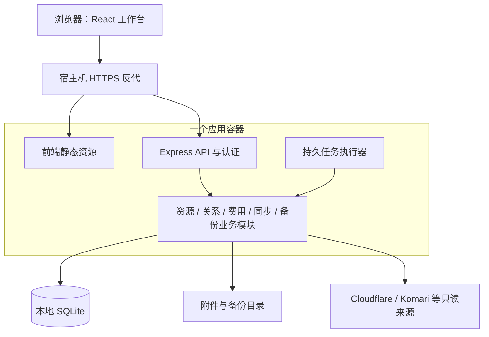

# 个人 CMDB 技术选型与架构评估

| 项目 | 内容 |
| --- | --- |
| 日期 | 2026-10-27 |
| 对应需求 | [PRD v3.0](PRD.md) |
| 状态 | 用户已确认 React 路线与 Docker 部署；资源核心功能已落地，目标机 Docker 镜像尚待验证 |
| 推荐组合 | React + TypeScript + Vite；shadcn/ui + Tailwind CSS；Express + TypeScript；SQLite + Drizzle |
| 开发模式 | 单仓库、按业务模块组织、前后端职责分开、同源单应用部署 |
| 设计理念 | 资源中心、关系可追溯、列表与详情协同、逐步展开信息、数据来源可解释 |

本文的选择结合实际 PRD 作出，官方文档用于核实工具能力，不代表工具作者对本项目的推荐。本文调整 PRD 中继续沿用原生 JavaScript 的初步建议，React / SQLite 资源核心已实施，完整产品仍按 PRD 分阶段推进。

## 1. 为什么需要升级

目标已经从三个 CRUD 台账发展为多个资源类型、关系、表单、筛选、外部观察和后台任务。继续手工拼接 HTML、维护全局状态和多次 JSON 写入，会让每项功能都承担重复的状态与一致性工作。

需要升级的三个重点是：

1. 前端组件化和类型约束，让列表、详情、表单和关系展示可以稳定组合。
2. 关系型存储和业务事务，让资源、部署、关联、历史一次完整变更。
3. 统一界面和交互规则，让查询、查看、编辑、确认、恢复的体验一致。

Express 本身不构成当前简陋感的来源，现有连接器与部署经验可以继续使用。

## 2. 方案比较

以下评价是面向这个项目的取舍，不是通用框架排名。

| 方案 | 适合之处 | 本项目中的代价 | 判断 |
| --- | --- | --- | --- |
| 原生 JS + Express + JSON | 上手直接，部署简单 | 复杂状态、表单、关系与可靠写入需要大量自行维护 | 留作现行基线，进入完整 CMDB 时升级 |
| React + Vite + 独立 Node API | 客户端交互边界明确，可组合表格、表单和关系图；现有 API 可逐步迁移 | 需要明确路由、数据获取、组件和构建规范 | 首选 |
| Vue 3 + Vite + Element Plus | 表单和后台交互体系适合快速形成完整管理界面 | 仍需设计领域组件和数据模型；采用默认样式不能保证产品辨识度 | 若长期主要维护者熟悉 Vue，可等价替换 |
| Next.js 全栈 | 统一页面与服务端开发；可组合服务端/客户端组件 | 本项目已有 Node API 和常驻任务，另引入渲染与缓存约定的收益暂不突出 | 可行，但当前不优先 |
| 新建 Fastify API | 路由 schema 校验与响应序列化有明确体系 | 需迁移现有中间件与路由约定；不直接提升页面质量 | 新建独立 API 时可选，本轮优先重构 Express |

React 官方提供 Vite 起步路径，也明确指出路由、数据获取等需要自行配齐；本方案因此明确指定这些基础设施，而非只换 React。[React 官方说明](https://react.dev/learn/build-a-react-app-from-scratch)

Vue 具有组件化、路由和状态管理生态；Element Plus 的设计原则强调一致、反馈、效率和可控，适合作为另一条完整路径。[Vue 官方文档](https://vuejs.org/guide/introduction.html)、[Element Plus 设计原则](https://element-plus.org/en-US/guide/design.html)

Next.js 的服务端组件有服务端取数、减少客户端脚本等用途；本项目不需要以公开内容渲染为中心，因此选择更明确的浏览器工作台与常驻 API 边界。[Next.js 官方文档](https://nextjs.org/docs/app/getting-started/server-and-client-components)

Fastify 的 schema 能力已经核实；Express 路线需用统一校验和响应 DTO 补上对应约束。[Fastify 官方文档](https://fastify.dev/docs/latest/Reference/Validation-and-Serialization/)

## 3. 推荐技术栈及责任

| 层次 | 选择 | 在本项目中的责任 |
| --- | --- | --- |
| 前端 | React + TypeScript + Vite | 组件、页面、类型约束、开发与生产构建 |
| 路由 | React Router | 资源详情 URL、嵌套页面、筛选参数、前进后退 |
| 服务端数据状态 | TanStack Query | 查询缓存、请求去重、失效刷新、提交后的列表/详情更新 |
| UI 与样式 | shadcn/ui + Tailwind CSS + 现有设计 token | 基础交互组件、布局、统一颜色/尺寸/状态 |
| 复杂列表 | TanStack Table | 排序、筛选、列显示、选择与分页的行为；视觉由领域组件提供 |
| 表单 | React Hook Form + Zod | 输入状态、校验、错误反馈、前后端公共输入契约 |
| 拓扑 | React Flow，随 R2 引入 | 可展开的资源节点/边；首版先交付正确关系列表 |
| API | Express 5 + TypeScript | 认证、接口、文件与静态页面服务、业务模块入口 |
| 数据 | SQLite + Drizzle | 表结构、查询、事务、外键/唯一约束和版本迁移 |
| 数据库驱动 | 优先验证 better-sqlite3 | 本地 SQLite；需验证目标 Node、CPU 架构和 Docker 镜像的安装/备份兼容 |
| 后台任务 | 持久任务表 + 应用内执行器 | 同步、探测、备份、重试、互斥与重启后的中断识别 |
| 部署 | Docker 单应用 + 本地持久卷 + 宿主机反代 | 同源提供 SPA/API；数据和附件持久化 |

shadcn/ui 将组件代码交给项目维护，可按现有视觉系统修改；这也意味着要维护本地改动和组件升级，不应把它当成无需设计的成品模板。[shadcn/ui 官方说明](https://ui.shadcn.com/docs)

TanStack Query 专门处理异步服务端状态；资源数据留在该查询体系，弹窗开关等局部界面状态留在组件内，筛选/当前资源放进 URL。[TanStack Query 官方说明](https://tanstack.com/query/latest/docs/framework/react/overview)

TanStack Table 提供表格行为而不决定外观，适合做统一的资源列表；React Flow 提供节点与连接交互，关系方向、布局和业务解释仍需本项目实现。[TanStack Table 官方仓库](https://github.com/TanStack/table)、[React Flow 官方文档](https://reactflow.dev/learn)

Zod 提供运行时 schema 校验与静态类型推导。前端校验改善交互，服务端仍要验证输入；资源是否存在、关系是否合法等规则由业务层和数据库检查。[Zod 官方说明](https://zod.dev/)

依赖采用相互兼容的稳定版本并锁定；不照搬文档中的 RC/preview 安装示例。首次实施时再确定准确版本，本评估不声称已完成组合运行验证。

## 4. 架构模式：模块化单体

前后端代码分开，生产同源部署。构建时生成前端静态文件，运行时由同一个 Node 应用提供静态文件、API 和后台任务入口。



### 4.1 代码组织

```text
apps/
  web/src/
    app/                    路由、应用壳和全局配置
    features/
      resources/            列表、详情、类型表单
      projects/
      relations/
      billing/
      sync/
      tasks/
    components/             基础 UI 与少量公共领域组件
  api/src/
    modules/
      resources/
      relations/
      billing/
      connectors/
      tasks/
      backups/
    infrastructure/         数据库、文件、网络、日志
packages/
  contracts/                API 输入/响应 schema、枚举、公共类型
```

当前采用单个 npm 工程组织 web/api/contracts 目录。业务代码按功能放在一起；路由处理 HTTP，业务操作维护规则与事务，数据访问负责查询。跨模块写入经过业务入口，不能绕过规则直接改其他模块的表。

### 4.2 一次操作的边界

以修改服务关联为例：验证提交版本与资源存在 → 计算关联差异 → 同一事务更新关联及历史 → 返回新版本 → 前端刷新相关查询。

TypeScript 不能代替运行时校验；共享 schema 不能代替授权与业务规则；ORM 不能代替数据库约束。三者分别负责不同问题。

### 4.3 后台任务

- 网络同步在事务外获取结果，完成后用短事务提交事实与差异，避免等待外部服务时占住数据库写锁。
- 任务表保存状态、范围、去重键、进度、重试信息与中断状态；应用执行器有并发限制和范围互斥。
- 运行保障采用可重试、幂等写入；不能只靠前端按钮禁用或进程内定时器保证任务正确。
- 页面先用查询轮询任务进度；确有体验收益时再采用服务端推送。
- CPU 密集的归档/大文件处理需分批或交给工作线程，保持 API 响应。

## 5. 数据设计理念

### 5.1 从 JSON 升级到受约束的数据

个人资源规模适合本地 SQLite。选择它是为了事务、关系和查询，不需要另部署数据库服务。[SQLite 适用场景](https://www.sqlite.org/whentouse.html)

- 公共资源表 + 类型详情表；少量自定义属性可用 JSON，核心外键、金额、日期、标识和关系使用结构化字段。
- 部署、入口、DNS、主机名与服务关联各有唯一维护入口，图上的边从事实派生，不重复保存另一套可编辑拓扑。
- 启用并验证外键、唯一约束和事务；SQLite 外键执行需要明确开启，不能假定默认生效。[SQLite 外键说明](https://www.sqlite.org/foreignkeys.html)
- 使用 revision 防旧页面覆盖新数据，使用唯一键处理同步/候选重复确认。
- 物理 schema 由迁移文件演进；Drizzle 管理类型化查询与迁移工具，迁移结果仍需人工审阅。[Drizzle SQLite 文档](https://orm.drizzle.team/docs/sqlite/get-started-sqlite)

### 5.2 运行与备份

可评估 WAL 改善读写并行，但 SQLite 同一时刻仍只有一个写入者，数据库使用本机卷；长任务采用短批次提交。[SQLite WAL 文档](https://www.sqlite.org/wal.html)

备份通过所选驱动支持的在线备份或受控快照进行，不能直接复制运行中的主数据库文件就认定完整；附件一致性另行协调。[SQLite 备份说明](https://www.sqlite.org/backup.html)

### 5.3 正式信息、观察与建议

人工资源资料、外部来源观察和待确认建议分开建模。界面始终能解释一个值来自哪里、多久以前获取、是否被人工覆盖、为什么认为两项资源有关。专业感来自能信任这些信息。

## 6. 产品设计理念

### 6.1 资源中心与项目视角并行

资源详情是主工作单元，有稳定地址。项目提供业务视角，资源类型提供技术视角；从任一视角进入的是同一条记录。

首页优先帮助查找和处理事项，显示搜索、收藏、最近访问、待确认变化、到期和备份异常。统计服务于行动，不占满主要工作区。

### 6.2 列表、预览与详情各有职责

- 列表：比较、过滤和批量处理，默认展示稳定列；支持保存视图。
- 侧边预览：快速检查少量信息，保留原列表位置；窄屏进入详情。
- 详情页：完整信息、关系、入口、部署、费用和历史，可刷新与前进后退。
- 编辑表单：简单项就地编辑，复杂结构用分区表单；保存错误保留输入，冲突显示差异。

### 6.3 逐步展开信息

首屏先回答用途、入口、位置和关键事项。来源元数据、完整 DNS、配置细节放在后续区域。类型差异用专用组件表达，公共字段和行为统一。

资源表单可以共享公共部分，但数据库、主机、订阅等专用字段由类型组件负责；不把完整产品做成一张庞大的动态字段表。

### 6.4 数据可解释与操作有反馈

- “使用中”“可达”“来源在线”“观察过时”各有独立标签，不能共用一个绿点。
- 关联展示人工确认/同步事实/推断建议；推断附理由，冲突能展开。
- 保存、复制、同步、导入、归档都具备执行中、成功、失败、重试和影响反馈。
- 无数据、没配置、未知、失败、已过时分别设计状态，不把所有情况显示成空白。

### 6.5 建立领域组件与视觉规范

保留现有暗色控制台方向，统一颜色、字号、间距、行高、边框、图标和交互状态。Tailwind 的主题变量可以表达设计 token，业务页面使用约定而非各自决定样式。[Tailwind 主题变量说明](https://tailwindcss.com/docs/theme)

在基础 UI 上建立 ResourceIdentity、ResourceTable、StatusLabel、RelationList、SourceInfo、MoneyValue、DateStatus、TaskProgress、DiffPreview 等领域组件。同一个状态、金额、来源和日期在所有页面采用同一种表达。

基础组件只是起点；键盘、焦点、移动端、长名称、批量选择、加载与错误状态仍需逐页验收。列表重信息对齐与可比较性，详情重层级与留白。

## 7. 开发模式与迁移路径

### 7.1 用完整功能推进

每轮同时完成模型、接口、页面、异常状态和对应 PRD 验收场景。首个完整功能选择“服务 → 主机名/入口 → 部署主机”，据此验证组件、契约、事务和迁移。

先把资源列表、资源详情、关联编辑、同步差异四类代表页面做完整，再推广到其他类型。以真实结构和极端样本验证视觉与操作，避免所有页面铺开后才发现底层模式不合适。

### 7.2 迁移顺序

1. 完成 R0：原始备份与现行数据风险修复。
2. 建立 TypeScript 契约和新存储模块，在副本迁移服务、域名、主机与部署，校验附件/关系。
3. 建立 React 应用壳与首个完整资源功能；复用经过校正的业务接口。
4. 新旧页面按路由逐步替换；切换存储时只有一个正式写入口，不长期维持 JSON/SQLite 双写。
5. 接入同步任务、费用、其他资源类型和恢复能力，按 R1 验收。
6. 再加入 R2 的交互关系图和持续维护能力。

### 7.3 开发与运维成本

引入 TypeScript/Vite 后会新增构建、类型检查和依赖升级工作，需在实际建立脚本后同步更新 AGENTS.md、README 与 Docker 多阶段构建。现阶段仓库仍没有这些命令，本次不声称它们已存在或通过。

组件源码需要维护；数据库驱动需验证运行环境；原生前端不能无成本自动转换。上述成本换取统一交互、可约束的数据关系和可持续增加资源类型的结构。

## 8. 首轮验证门槛

| 验证项 | 通过标准 |
| --- | --- |
| 栈兼容 | 稳定依赖组合可在目标 Docker/Node 环境构建启动 |
| 垂直功能 | 一个服务从建档到入口/部署/反查完整可用 |
| 一致性 | 事务回滚、重复提交、旧版本冲突符合 PRD |
| 数据迁移 | 原始备份可恢复，数量/字段/关系/附件校验通过 |
| 体验 | 桌面与 390px 下列表、详情、编辑、错误状态完成验收 |
| 单应用部署 | 同源静态资源/API/任务正常，刷新详情不 404，认证不被 SPA fallback 绕过 |
| 可恢复 | 所选 SQLite 驱动能完成备份与新实例恢复，附件和配置一致 |

这些门槛通过后，才把建议技术栈标记为已验证的实施基线。

## 9. 实施记录（2026-10-27）

- 已确定 React + TypeScript + Vite、Express + TypeScript、SQLite + Drizzle、Docker 多阶段部署。
- 已落地资源/项目/关系/入口/部署/历史/回收站核心流程与旧接口兼容；路由页面按需加载。
- 已加入受控初始化、会话撤销、连接器密钥加密和一致数据库快照；原 JSON 仅作为一次迁移输入。
- 已运行实际 build/typecheck，63 项隔离 API/迁移/认证/备份检查通过，浏览器验证桌面及 390px 详情/编辑无横向溢出。
- 当前环境无 Docker 命令，尚未执行镜像构建和容器验收；宿主机应用验证不替代容器验证。
- 同步仍在请求内执行；持久任务/定时调度、完整费用/到期系统、交互拓扑、文件导入和完整恢复向导尚待开发。
- 本阶段不标记 R0 或 R1 全部验收通过，具体边界见 README。
