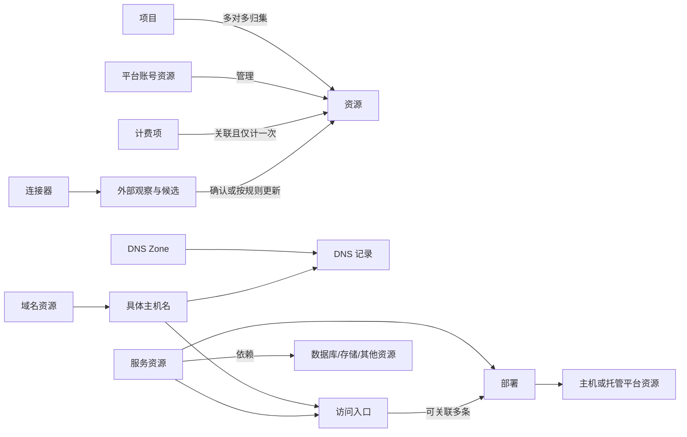

# 个人 CMDB 产品需求文档

| 项目 | 内容 |
| --- | --- |
| 文档版本 | v3.0 |
| 更新日期 | 2026-10-27 |
| 产品代号 | domain-manage；名称暂不调整 |
| 产品定位 | 用一个网站管理个人所有在线资源，记录资源、关系、用途、入口、状态、费用与维护事项 |
| 使用方式 | 单用户、自部署、多设备访问；桌面管理，手机随时查询与处理事项 |
| 文档状态 | 完整产品目标；资源核心已部分实施，未完成范围与验证边界见 README/ARCHITECTURE |
| 当前实现 | React + TypeScript + Vite、Express API、SQLite + Drizzle 的资源核心版本；Docker 配置已更新，目标机容器验证待完成 |
| 配套文档 | [README.md](README.md)：现行运行方式；[DESIGN.md](DESIGN.md)：现行视觉规范；[AGENTS.md](AGENTS.md)：代码协作约定；[ARCHITECTURE.md](ARCHITECTURE.md)：技术选型与架构评估 |

> 本文替代 v2.1 的轻量域名台账规划。产品范围升级为个人 CMDB，继续采用单用户、自部署形态。目标能力不能当作代码已经具备的能力；实施状态以第 18 章和实际验收结果为准。

## 1. 产品定义与目标

### 1.1 一句话定义

一个属于自己的在线资源总台账：知道自己拥有什么、为什么需要它、在哪里运行、依赖什么、如何访问、何时续费，以及变更时会影响哪些东西。

### 1.2 需要解决的问题

资源分散在域名注册商、DNS 平台、VPS、云平台、自部署应用、数据库、对象存储、SaaS 和 API 服务中。各平台能看到自己的数据，但跨平台的资源关系、业务用途与维护经验仍留在脑子或零散笔记里。

本产品把这些信息连接起来，形成个人可维护、可查询、可恢复的资产记录。已有专业平台继续提供监控和资源操作能力，本产品保留其入口并消费必要的只读信息。

### 1.3 产品目标

| 编号 | 目标 | 可观察结果 |
| --- | --- | --- |
| G-01 | 资源有完整入口 | 所有在用资源均可登记；未知类型可先作为其他资源收录 |
| G-02 | 资源能解释清楚 | 有名称、用途、所属项目、来源和管理入口；缺失项明确显示 |
| G-03 | 关系可以追溯 | 能从域名找到服务、部署、主机与依赖，也能反向查询 |
| G-04 | 日常维护有着落 | 待确认发现、同步失败、到期和资料缺失汇总为可处理事项 |
| G-05 | 信息保持可信 | 人工确认、自动观察和推断有区分，显示时间、来源与冲突 |
| G-06 | 数据可以带走和恢复 | 支持可迁移导出、完整备份、恢复预检和回滚 |

### 1.4 设计假设

- 只有一个使用者，但可能在电脑和手机上同时打开多个页面。
- 首先管理域名、主机、自部署服务及其依赖，并逐步录入云资源、SaaS 和 API 订阅。
- 主要集成继续是 Cloudflare 与 Komari；其他平台先通过手工登记、文件导入和管理入口接入。
- 正式版覆盖所有资源类型，不要求所有平台都已有自动连接器。
- 本次不访问线上账号或收集真实资产清单；实际清单在首轮使用时导入或补录。

## 2. 当前项目基线

本章记录 2026-10-27 改造前的代码基线与临时副本复现；部分问题已在 0.2.0 资源核心改造中修复，当前状态见 README。这里不代表已验证生产部署状态。

| 模块 | 当前已有 | 当前缺口或问题 | 处置 |
| --- | --- | --- | --- |
| 域名 / 服务 / 服务器 | 增删改查、搜索、卡片、部署记录 | 缺少完整详情页与统一资源结构；字段覆盖范围有限 | 保留现有资产，逐步进入统一模型 |
| 资源关系 | 服务域名字符串、域名 service_ids、部署外键 | 双向修改不同步；删除服务残留引用；域名改名不同步 | 统一关系入口与事务边界 |
| Cloudflare | zone 与 DNS 查询、手工同步 | 不同主机名 IP 混入根域名；删除记录留旧值；缺少完整分页 | 重建同步映射与完整性判断 |
| Komari | 只读导入、节点绑定、状态与续费快照 | 缺少统一同步历史、失效处理与字段冲突机制 | 保留连接器，纳入同步中心 |
| HTTP 探测 | 标题、类型、状态码、TLS 异常、默认页识别 | 404 可能被判为有效服务；部署固定 https:443；并发推断可重复建档 | 拆分探测事实、发现建议与正式入库 |
| 数据存储 | 单 JSON 文件、Docker 数据卷 | 非原子覆盖；关联变更多次写入；缺少版本化迁移 | 先保证原子性与一致性，再实施目标模型 |
| 导出与恢复 | 浏览器台账 JSON 导出、README 手工卷备份命令 | 导出不是完整备份；无导入恢复界面；旧迁移脚本丢字段且备份错误 | 明确导出、备份、恢复三套流程 |
| 登录与安全 | 单口令、scrypt、HttpOnly 签名会话、登录失败限制 | 首次初始化暴露；字段白名单、属性转义和上传校验不足 | 保留单用户入口并补齐边界 |
| 前端与部署 | 暗色控制台、移动适配、Docker、宿主机反代 | 页面状态不保留；查询与编辑混合；模块耦合；运行维护信息不足 | 渐进拆分，保持现有视觉方向 |

基线审阅时没有构建/类型检查脚本；技术改造后已新增实际 build/typecheck，仍无 test/lint 脚本。本文验收场景覆盖完整目标，不代表现阶段全部通过。

## 3. 资源范围与产品边界

### 3.1 可管理的资源

| 分类 | 典型对象 | 重点记录 | 首版收录方式 |
| --- | --- | --- | --- |
| 域名 | 注册域名、获分配的管理域、委派子域 | 用途、注册商、管理范围、账号、续费、关联主机名 | 手工、Cloudflare、文件导入 |
| 主机 | VPS、云主机、独立服务器、可承载服务的自有设备 | 多 IP、供应商、地区、系统、规格、续费、管理入口 | 手工、Komari、文件导入 |
| 服务 | 网站、自部署应用、API、后台、自动化服务 | 用途、项目、环境、访问入口、部署、依赖、代码与文档入口 | 手工、发现候选、文件导入 |
| 数据库 | 数据库实例、托管数据库、共享实例中的独立数据库 | 引擎、地址与端口、托管位置、使用服务、备份说明 | 手工、文件导入 |
| 存储 | 对象存储桶、网盘空间、持久化卷、备份仓库 | 类型、位置、容量信息、用途、依赖、备份与管理入口 | 手工、文件导入 |
| 云资源 | PaaS 项目、容器托管平台、CDN、队列、邮件服务、网络资源 | 子类型、供应商、账号、区域、外部标识、资源入口 | 手工、文件导入 |
| 订阅与 API | SaaS 套餐、模型 API、开发工具订阅、付费在线服务 | 套餐、用途、账号、计费项、额度观察、管理入口 | 手工、文件导入 |
| 账号 | 云平台、注册商、DNS、SaaS 等平台的账号身份 | 平台、账号别名、登录标识、所属资源、控制台与凭据引用 | 手工、文件导入 |
| 其他资源 | 暂无专用模型的在线资源 | 用途、链接、属性、关系、来源 | 手工、文件导入 |

项目、标签、供应商是组织信息；DNS 记录、访问入口和部署是结构化事实，不重复算作顶层资产。容器需要独立生命周期时作为服务/云资源登记，仅记录容器名时放在部署内。

### 3.2 正式产品覆盖的管理行为

- 登记、查询、筛选、收藏、关联、编辑、归档、回收站和历史追溯。
- 手工与只读连接器补充信息，显示变化、冲突、失败与过时状态。
- 查看依赖和潜在影响，跳转专业后台完成实际操作。
- 维护费用、到期、续费确认、资料完善与个人事项。
- 导入、导出、备份、恢复和版本升级迁移。

### 3.3 当前产品边界

- 单用户；无需组织架构、多人审批、租户、权限角色或公开注册。
- 连接器只读；不修改 DNS、不创建云主机、不部署容器、不执行远程命令、不提供 SSH 终端。
- 沿用 Komari 观察主机状态；不重复建设主机监控采集和时序平台。
- 凭据仅保存引用；不建设密码管理器，不存 SSH 私钥或资源登录密码。连接器访问密钥作为独立敏感配置处理。
- 成本用于个人预算与续费安排；不提供支付、扣费或会计报表。
- 后续新增云服务商连接器、通知渠道、PWA、公开 API 均独立排期。

## 4. 核心使用场景

| 编号 | 场景 | 操作路径 | 完成结果 |
| --- | --- | --- | --- |
| U-01 | 第一次整理所有资源 | 初始化 → 配置来源 → 同步预览/导入文件 → 处理候选 → 补用途与项目 | 形成初始台账，并看到尚未完善的记录 |
| U-02 | 想起一个域名，不记得用途 | 全局搜索 → 主机名/域名详情 → 服务 → 部署与依赖 | 知道是什么、在哪、如何访问和管理 |
| U-03 | 新建了一个应用 | 新增服务 → 选择项目 → 添加入口、部署和依赖 → 关联计费项 | 相关资源能相互查询；允许先填最少字段 |
| U-04 | 准备迁移或停用 VPS | 主机详情 → 关联部署 → 反向依赖/潜在影响 → 迁移事项 | 看到已记录的服务、数据资源与域名入口；明确未知部分 |
| U-05 | 不知道费用花在哪里 | 费用 → 按币种、供应商、项目查看 → 打开计费项 | 解释月度估算、续费项与共享费用来源 |
| U-06 | 收到续费通知 | 待办 → 到期项 → 跳转供应商 → 确认续费 → 填新日期与金额 | 本次事项关闭，历史保留，下期事项重新计算 |
| U-07 | DNS 或上游节点变化 | 同步中心 → 差异 → 确认关联建议 | 自动事实更新，人工配置保留，冲突得到处理 |
| U-08 | 某网站打不开 | 服务 → 入口最近探测 → Komari 状态 → 管理入口 | 区分 DNS、HTTP、TLS、主机状态与记录缺失 |
| U-09 | 手机临时查信息 | 搜索 → 详情 → 复制域名/IP/端口或打开入口 | 不依赖桌面悬停，不需要进入编辑表单 |
| U-10 | 换机器或误操作后恢复 | 恢复 → 预检 → 查看影响 → 执行 → 校验 | 资源、关系、附件和设置按规则恢复 |

## 5. 产品规则

1. **人工记录、外部观察、推断建议分别保存。** 自动数据不能无提示覆盖人工确认内容。
2. **每一条关系只有一个写入入口。** 两侧页面修改同一条关系；派生展示不维护第二份可编辑数据。
3. **未知就是未知。** 没配置、没同步、无响应、同步失败和过时不能展示成正常、零费用或无风险。
4. **先支持录入，再逐步自动化。** 新平台没有连接器时仍能完整建档。
5. **重要信息可以反查。** 服务看依赖，主机看承载，账号看资源，费用看归属。
6. **一次操作完整提交。** 资源、关系、历史和附件引用要么一起成功，要么保持原状。
7. **归档保留历史。** 上游消失、当前不可达和人工退役分别处理。
8. **轻量部署。** 一个应用与一个持久化数据目录即可运行，核心功能不依赖额外常驻服务。

## 6. 信息架构与页面

### 6.1 桌面导航

```text
总览
项目
资源
  全部资源
  域名与 DNS
  主机
  服务
  数据库与存储
  云资源与订阅
  账号与其他
关系与影响
费用与到期
待办
同步中心
设置
```

分类是统一资源集合的筛选入口。项目、供应商、账号与类型可以组合筛选，不建立互不相通的独立台账。全局提供搜索、新建、待处理数量与当前位置。设置包含连接器、口令与会话、数据管理和运行信息。

### 6.2 页面职责

| 页面 | 必须呈现的信息 | 主要操作 |
| --- | --- | --- |
| 总览 | 资源分布、收藏、待办、近期到期、同步/备份异常、最近变更 | 搜索、录入、进入事项与资源 |
| 项目列表/详情 | 用途、资源分组、关键入口、依赖、关联费用、缺失信息 | 关联已有资源、新增资源、查看共享资源 |
| 资源列表 | 名称、类型、用途摘要、项目、生命周期、来源/更新时间、类型关键字段 | 组合筛选、排序、收藏、批量操作、进入详情 |
| 资源详情 | 基础信息、入口、关系、部署/技术属性、观察状态、费用、事项、历史 | 复制、打开后台、编辑、关联、归档 |
| 域名与 DNS | 管理域、zone、主机名、DNS 记录、入口与匹配建议 | 查询主机名、查看记录、来源和同步状态 |
| 关系与影响 | 上下游、方向、依据、确认状态、覆盖限制 | 定位资源、展开关系、处理建议 |
| 费用与到期 | 各币种估算、明细、共享费用、近期到期、未知金额/日期 | 编辑计费项、确认续费、筛选 |
| 待办 | 来源、关联资源、原因、截止时间、处理状态 | 完成、稍后处理、忽略、跳到具体问题 |
| 同步中心 | 来源状态、运行记录、进度、增量、失败范围、冲突与候选 | 同步、重试失败项、预览、批量确认 |
| 数据管理 | 导入预检、导出范围、备份记录、恢复预检、缺失密钥 | 导入、下载、备份、恢复、查看校验结果 |

### 6.3 资源详情

- 首屏：名称、图标、类型、用途、项目、生命周期、主要访问/管理入口、更新时间。
- 内容区：概况、关系、类型详情、费用与事项、历史。空区域显示“未记录”及补录入口。
- 域名展示主机名与 DNS；主机展示承载与 Komari；服务展示入口、部署和依赖；账号展示所属资源。
- 搜索直接进入详情；编辑在详情内打开，保存后保持上下文。
- 详情、项目、筛选支持稳定 URL、刷新、浏览器前进后退；分享链接仍需登录。

### 6.4 视觉与交互

- 沿用 DESIGN.md 的暗色应用壳、靛紫强调色、Inter/JetBrains Mono、4–12px 圆角与紧凑信息密度。
- 新导航在现有应用壳内展开；视觉规范随 UI 实施补充，本次不修改 DESIGN.md。
- 列表便于比较；域名/服务支持卡片和表格并记住选择；保留相似域名差异高亮与图标兜底。
- 手机底部导航为“总览 / 资源 / 待办 / 更多”；项目、费用、同步和设置从更多进入。
- 390px 宽度可查询、编辑、复制、处理候选和续费；窄屏表格转卡片。
- 弹窗有焦点约束、Esc 关闭、焦点恢复；未保存退出有提示；提交中避免重复操作。
- 状态有文字说明；复制和外链为明确按钮；支持键盘与减少动态效果偏好。

## 7. 领域模型

### 7.1 模型结构

采用“统一资源公共字段 + 类型详情 + 专用事实表 + 有类型的关系”。首版固定类型，不建设可编程模型设计器。



结构化事实关系由对应记录派生展示。通用关系表只保存用户明确维护的关系，不能另存一份可编辑的部署/入口关系。

### 7.2 资源公共字段

| 字段 | 要求 | 规则 |
| --- | --- | --- |
| id | 系统生成 | 稳定且不可由客户端修改；迁移尽量保留原 ID |
| type / subtype | 类型必填 | 类型固定；子类型用于引擎、云资源分类；改类型需预检 |
| name / aliases | 名称必填 | 中文名称与多个别名；名称不是唯一标识 |
| purpose | 可后补 | 一句话用途；缺失进入资料待完善列表 |
| lifecycle | 必填 | 规划中、使用中、暂停、已退役、已归档；不表示在线状态 |
| project_ids / tags | 可后补 | 多对多；共享资源可属于多个项目 |
| provider_id / account_id | 可后补 | 供应商为目录；账号指向账号类型资源 |
| management_url / docs_url | 可后补 | 后台与说明；服务访问 URL 另存入口 |
| icon / brand_color | 可选 | 图标失败使用 Monogram；稳定配色或手设 |
| notes / credential_ref | 可选 | 备注与密码管理器条目说明；不填真实密码/私钥 |
| external_refs | 外部发现时记录 | 来源、对象类型和外部 ID；可有多个来源 |
| revision | 系统字段 | 乐观并发版本；旧页面修改不得静默覆盖新内容 |
| 时间与删除标记 | 系统字段 | 创建、修改、归档、软删除时间；观察时间单独记录 |

新建只要求类型、名称及该类型的必要标识。用途、项目缺失不阻止快速登记，但必须可筛选。

### 7.3 各类型详情

| 类型 | 必要标识 | 可选结构化字段 |
| --- | --- | --- |
| 域名 | 规范化域名 | 管理范围、注册商、注册到期日、自动续费；不从 DNS 商推定注册商 |
| 主机 | 名称；有 IP 时规范化地址 | 多 IPv4/IPv6、地区、系统、规格、SSH 端口、Komari；无公网 IP 可登记 |
| 服务 | 名称 | 类别、仓库、文档、重要程度；环境/版本放在部署和入口 |
| 数据库 | 名称 | 引擎、版本、实例/数据库层级、地址/端口、承载资源、备份说明和观察时间 |
| 存储 | 名称 | 类型、桶/卷/空间标识、区域、容量、承载资源、备份说明 |
| 云资源 | 名称与子类型 | 平台、区域、外部标识、控制台、自定义属性 |
| 订阅与 API | 名称 | 套餐、服务入口、计费类型、额度单位、余额观察及时间；费用在计费项维护 |
| 账号 | 平台与账号别名 | 邮箱/用户名、控制台、恢复方式说明、凭据引用；支持隐藏登录标识 |
| 其他 | 名称 | 子类型、链接、用途、自定义属性 |

自定义属性支持文本、数字、日期、布尔、链接和单选，默认每类型最多 20 项；可搜索，不能注入脚本、公式或替代核心关系。

### 7.4 项目与供应商

- 项目记录名称、用途、生命周期、标签、主要入口和备注。重名提示，不靠名称关联。
- 资源可属于多个项目，并标记主要项目；跨项目依赖显示共享标识。
- 供应商记录名称、官网/控制台、备注；同一供应商可有多个账号。
- 删除项目/供应商前显示影响，默认归档；解除分组不能删除资源或计费项。

### 7.5 域名、主机名、Zone 与 DNS

- 域名资产表示用户管理的域，不强制是可购买的注册根域名。
- 主机名记录规范化 FQDN、可选所属域名；一条主机名可有多条 DNS 记录、多个服务入口。
- Zone 表示 DNS 管理区，可为根域或委派子域；不靠截取字符串猜注册边界。
- DNS 记录保存来源、zone、外部 ID、名称、类型、内容、TTL、代理标记、观察时间和来源存在状态。
- 首版完整保留 Cloudflare 返回类型；A/AAAA/CNAME 用于关联建议，MX/TXT 等用于查询；敏感内容导出时可排除。
- 同名不同类型/内容可并存；通配符原样展示，不能伪造大量具体主机名。
- CNAME 展示每一跳、循环与未知终点；外部目标只记录名称即可，不强制成为自己的资产。
- Cloudflare 代理、共享 IP、CDN、负载均衡不能单独证明实际部署位置。

### 7.6 访问入口与部署

访问入口保存服务、规范化 URL、用途、环境、可选主机名关联、主要入口标记、期望响应和最近探测。主机名入口引用同一条服务与主机名关联；添加 URL 时在同一操作内创建或复用这条关联。公网、内网、管理入口可以并存；URL 不存认证信息或带密钥的查询参数。

部署保存服务、承载资源、环境、内部协议/端口、路径、容器/实例名、版本、生命周期、备注和确认来源。承载对象可以是主机或云托管平台。第三方 SaaS 可以没有自有部署。

入口与部署显式多对多关联。外部访问 443 和内部监听 3000 分开记录。重定向或入口可达不能证明内部端口、承载位置与容器信息。

### 7.7 关系类型与一致性

| 关系 | 方向 | 唯一维护入口 |
| --- | --- | --- |
| 项目包含资源 | 项目 → 资源 | 项目资源关联表，双向共用 |
| 账号管理资源 | 账号 → 资源 | 资源账号绑定；反向派生 |
| 服务具有入口 | 服务 → 入口 | 入口记录 |
| 服务部署于资源 | 服务 → 承载资源 | 部署记录 |
| 数据资源承载于资源 | 数据库/存储 → 承载资源 | 类型详情中的承载绑定 |
| 服务使用主机名 | 服务 → 主机名 | 显式 service_hostnames 关联；入口引用此关联，双向编辑共用 |
| 依赖 | 使用方 → 被依赖资源 | 通用关系；强/弱/未知依赖 |
| 备份到 | 源资源 → 存储资源 | 通用关系；只记录说明，不承诺备份任务成功 |
| 关联 | 资源 ↔ 资源 | 通用关系；无方向补充联系 |

- 禁止无效目标、自关联与同语义重复关系；循环依赖允许登记但提示，遍历去重。
- DNS/IP 匹配只产生候选；确认后才成为部署归属，保留依据与确认时间。
- 改名保持 ID，不断关系；变更域名标识需显示影响并使旧探测失效。
- 显式承载与部署优先于 IP 猜测；不同来源冲突同时展示。
- 任一侧修改后两侧一致；更新失败保留原关系。
- 可以先关联服务与主机名，再补具体入口。移除仍有入口引用的关联时，先展示影响并要求调整或移除这些入口，不能留下矛盾事实。
- 影响分析默认两跳，可扩展；标明“基于已记录关系”，未知不能显示为无影响。

### 7.8 唯一性与重复识别

- (connector_id, object_type, external_id) 唯一；同步使用外部标识，不靠名称。
- 主机名按小写、去尾点、IDN 规范化后唯一，保留可读形式；IP 规范化后比较。
- 主机、账号、数据库不能因同 IP 或同名自动合并；共享地址允许存在。
- 同服务、环境与规范化 URL 的入口不得重复；同 URL 属于不同服务时提示确认。
- 重复提交或多设备确认同一候选只产生一条正式记录。
- 合并前展示字段、关系、附件、历史和外部绑定处理方案；原 ID 留追溯，不静默丢信息。

## 8. 信息来源、状态与生命周期

### 8.1 字段归属

每个自动字段保存来源、来源对象、观察时间和最近同步任务。显示值按以下规则生成：

| 内容 | 归属与更新规则 |
| --- | --- |
| 名称、用途、项目、标签、备注、人工关系 | 用户维护；同步只提出建议 |
| DNS 内容、TTL、代理标记 | 来源事实；完整同步后更新，人工说明另存 |
| Komari 节点规格、状态、费用快照 | 来源观察；与人工主机信息、正式计费项分开 |
| IP、地区等可能两边维护的字段 | 自动值与人工覆盖同时保留；界面可锁定人工值、撤销覆盖或接受新值 |
| 页面标题、服务类型识别 | 探测建议；不自动替换正式名称、用途或部署 |
| 到期、套餐价格 | 手工为正式信息；连接器提供观察与差异，用户可明确启用来源跟随 |

移除连接器不会删除正式资源；保留最后观察并标记来源断开。更换同平台账号不能继承旧账号的对象归属。

### 8.2 状态分开表达

| 维度 | 取值示例 | 说明 |
| --- | --- | --- |
| 生命周期 | 规划中 / 使用中 / 暂停 / 已退役 / 已归档 | 人工管理意图 |
| 入口观察 | 未检查 / 可达 / 需认证 / 异常 / 不可达 / 已过时 | 来自一次 HTTP/TLS 检查 |
| 主机观察 | 未关联 / 未知 / 在线 / 离线 / 已过时 | 来自 Komari，保留来源时间 |
| 来源存在状态 | 存在 / 来源已移除 / 未验证 | 只有完整成功同步才能确认移除 |
| 同步状态 | 未配置 / 可用 / 执行中 / 部分失败 / 失败 / 暂停 | 来源工作状态 |
| 资料状态 | 完整 / 待补用途 / 待关联项目 / 待确认关系等 | 可解释的完整性检查 |

不将“使用中”展示成探测在线；DNS 有记录不等于网站可访问；一次检查失败不自动改变生命周期。

### 8.3 过时规则

- Komari 状态默认超过来源观察时间 3 分钟即标记过时；接口成功返回旧状态也不能刷新为刚刚在线。
- DNS 观察默认 24 小时未成功更新提示过时；自动周期默认为 6 小时，可关闭。
- 一次性 HTTP 检查默认 24 小时后显示“历史检查”；用户可再次检查，不能假装是持续监控。
- 额度、费用、到期保留各自观察时间；页面显示来源最近成功时间与失败原因。
- 原始来源缺少时间时记录本次获取时间，并标记“来源未提供观察时间”。阈值可在设置调整。

### 8.4 归档、删除与恢复

- 默认归档已不用的资源；归档后仍可搜索历史、关联和费用，不参与在用资源统计。
- 删除进入回收站，默认保留 30 天；保留关系记录并标记目标在回收站，不产生悬空 ID。
- 删除前显示受影响的入口、部署、依赖、计费项和附件；不得连带删除其他正式资源。
- 恢复时校验关系目标；目标已永久删除时提示补关联，不静默绑定到同名新资源。
- 永久删除必须先解决或明确解除正式引用；历史可保留不含敏感信息的名称快照。
- 上游来源再次发现已归档/删除对象时，不自动恢复；提供重新收录入口与忽略规则。

## 9. 同步与发现

### 9.1 连接器结构

连接器记录类型、名称、所属账号、访问范围、配置引用、状态、调度和最近成功时间。Cloudflare 与 Komari 首版各支持单个配置；数据模型用 connector_id 隔离，多个账号实例在后续版本开放。

密钥由环境变量优先提供，界面显示配置来源与覆盖关系。保存密钥、验证连接、保存同步规则是独立动作；“测试连接”不会默默覆盖正式配置。连接失败不能提示台账登录失效。

### 9.2 同步流程

1. 创建同步任务，记录来源与范围；同一来源和范围已有任务时返回当前任务，不重复启动。
2. 获取所有分页，保存每个范围的结果、错误和完整性；限制并发和总执行时间。
3. 生成新增、变化、疑似重复、冲突、来源移除和关系建议。
4. 已绑定对象更新来源观察；人工字段保持原值。新的顶层资源默认进入候选区。
5. 用户可批量确认候选；允许显式开启指定类型的自动收录。推断的部署归属始终需要确认。
6. 只有完整成功的范围可以标记来源移除；部分失败不能清空旧数据，也不能标记未抓到的对象已删除。
7. 显示汇总和逐项结果；用户可以重试失败范围，而不是只能从头重跑。

任务在后台运行，接口及时返回任务标识；页面可离开后回来查看。首版不要求额外队列服务，任务状态需持久化。进程重启后将未完成任务标记中断，支持安全重试；多次重试不重复建档。

### 9.3 Cloudflare 规则

- 读取用户授权范围内的全部 zone、全部 DNS 分页，记录同步覆盖范围；没有权限的范围显示明确原因。
- 按记录名称建立具体主机名；A/AAAA 只关联该主机名，禁止把同 zone 的 IP 全部合并到根域名。
- DNS 供应商记录为 Cloudflare；注册商未知时保持未知。
- A/AAAA/CNAME 为关联建议提供依据；同一主机名多地址或 CNAME 链保留完整结构。
- 不将私网、回环、丢弃地址当作公网主机匹配依据；原记录仍保留并标记用途/特殊地址。IPv6 按地址语义判断，不靠字符串前缀猜测。
- 主机名停止使用 A/AAAA、改用 CNAME 或记录被移除后，旧地址不能继续显示为当前解析结果。
- DNS 事实视图展示配置记录，不能冒充全球实时 DNS 解析结果；独立解析检查若实现，必须分开标注。
- zone 迁移账号、记录外部 ID 改变、同主机名多来源时显示差异；不自动合并不同账号资源。

### 9.4 Komari 规则

- 沿用现有只读查询和公开接口降级能力；显示当前来源、降级原因、节点数与观察时间。
- 优先用已绑定节点 UUID 找主机；IP 仅用于候选匹配，多重匹配时不自动选择第一台。
- 未配置密钥或公开接口无 IP 时，只展示可用观察，允许手动绑定，不生成虚假的 IP 归属。
- 导入候选去重；同步不覆盖人工名称、用途、项目或备注。
- 节点消失标记来源移除；查询状态失败标记未知/过时，不能把缺失状态直接当离线。
- 节点费用与到期先进入观察区；确认后创建或绑定计费项，不重复计入总费用。
- 隐藏节点不自动导入；已关联隐藏节点仅按可读取范围展示并说明状态。

### 9.5 HTTP/TLS 检查与服务候选

- 只检查已登记入口或明确选中的已知主机名，支持单个/批量执行；不提供任意 URL 开放代理。
- 默认无认证 GET；整次检查总时限默认 10 秒，含重定向、TLS 重试与 HTTP 回退；最多 5 次重定向，正文上限 64KB，并发默认 4。
- 默认 2xx/3xx 表示响应可达；401/403 标记需认证；404 标记未找到入口；429/5xx 标记异常。可为特定入口设置期望状态，但不能改变已收到的原始状态码。
- TLS 异常单独展示；可进行无凭据的诊断性容错读取，结果不能显示成证书正常，不能全局关闭证书校验。
- 保存原始状态、最终 URL、协议、标题、识别类型、占位页标记、TLS 结果、检查时间与总耗时；不存完整网页正文。
- 默认页、错误页、挑战页和跨站跳转只能产生带原因的候选，不能直接成为“运行中”的正式服务。
- 从候选确认时使用实际入口协议/端口；内部部署端口、主机与容器名未知就留空。
- 一台主机多服务、一个服务多域名、一个域名多路径时，用户可选择关联已有服务，不能“一域名强制一服务”。
- 不在打开空台账时无提示创建正式服务。初次引导可运行发现，但必须展示结果和入库选择。

### 9.6 调度与失败恢复

- 首版提供手工同步、任务进度、历史、失败重试；定时同步在 R2 提供，默认可关闭。
- R2 的 Cloudflare 默认每 6 小时；Komari 页面可见时约 60 秒刷新，后台资产快照默认每日一次；HTTP 定时检查默认关闭。
- 调度统一处理超时、退避、速率限制、同范围互斥与重启；错过的周期合并执行一次，不在启动后补发大量任务。
- 页面无关的到期事项与备份依靠服务端任务生成；关闭浏览器后仍工作。
- 外部平台不可用时，已有台账、搜索、人工编辑和数据导出仍可使用。

## 10. 功能需求清单

优先级定义：P0 为 R1 正式自用版必须完成；P1 为 R2 完善版；P2 为后续选做。R0 是实现 P0 前必须完成的数据安全基线。依赖某项能力的验收，必须等前置阶段交付后执行。

| 编号 | 需求 | 优先级 | 核心验收 |
| --- | --- | --- | --- |
| FR-01 | 九类资源的统一建档、详情、编辑与查询 | P0 | 每类型至少一条记录完成录入、修改与重新查询 |
| FR-02 | 类型详情、少量自定义属性、附件和外部入口 | P0 | 不用把 IP/端口/依赖塞进备注；图片失败有兜底 |
| FR-03 | 项目、供应商、账号、标签组织 | P0 | 资源在多个项目中展示同一记录，账号可反查资源 |
| FR-04 | 收藏、最近访问和 URL 状态保留 | P0 | 刷新详情、返回列表后保留筛选与位置 |
| FR-05 | 全局搜索与 Cmd/Ctrl+K | P0 | 名称、别名、域名、IP、标签、用途、备注和项目可命中 |
| FR-06 | 保存的筛选视图、拼音首字母搜索 | P1 | 保存“在用且未填用途”等视图；中文别名可用首字母查找 |
| FR-07 | 域名/主机名/Zone/DNS 分层 | P0 | 根域与子域解析不同机器时分别正确展示 |
| FR-08 | 服务入口、部署、环境和数据依赖 | P0 | 一服务多入口/多部署可反查；外部与内部端口分别记录 |
| FR-09 | 关系双向维护和上游/下游列表 | P0 | 任一侧修改都一致；改名不丢关系 |
| FR-10 | 潜在影响查询 | P0 | 主机能列承载及依赖链；显示未知与覆盖限制 |
| FR-11 | 可交互关系图 | P1 | 按项目/类型过滤，展开节点，循环关系不会卡住页面 |
| FR-12 | 生命周期、归档、回收站与恢复 | P0 | 删除显示影响；恢复关系需校验；上游不自动复活对象 |
| FR-13 | 变更历史与来源追踪 | P0 | 人工/同步/导入均可查看操作、时间、来源与字段变化 |
| FR-14 | Cloudflare 完整只读同步 | P0 | 全分页、准确主机名、部分失败保护、旧地址失效 |
| FR-15 | Komari 只读集成与准确状态 | P0 | UUID 稳定绑定；无 IP/状态时显示未知与降级原因 |
| FR-16 | 候选发现、忽略和批量确认 | P0 | 可新建/关联已有/忽略；重复确认不重复入库 |
| FR-17 | 同步中心、持久任务与冲突处理 | P0 | 离开页面后继续；中断可重试；人工覆盖不丢失 |
| FR-18 | 定时同步与手动覆盖规则 | P1 | 浏览器关闭仍执行；互斥、退避、来源失效可解释 |
| FR-19 | 单次 HTTP/TLS 检查 | P0 | 状态码、证书、占位页、时间分开显示，404 不自动建服务 |
| FR-20 | 基础计费项、日期与按币种估算 | P0 | 免费/未知分开；共享项只计一次；可确认续费 |
| FR-21 | 费用趋势、项目分摊和额度事项 | P1 | 估算与实际分开，项目合计不重复，未知额度不显示 0 |
| FR-22 | 到期、资料缺失、同步冲突等站内事项 | P0 | 事项跳到具体问题，处理后关闭，生成有去重键 |
| FR-23 | 完整站内周期与提醒调度 | P1 | 相同周期去重，忽略/稍后处理生效，无需常开页面 |
| FR-24 | 批量标签、归档和文件导入 | P0 | 先预览范围与错误；不会误覆盖其他记录 |
| FR-25 | 服务端数据导出、完整备份和恢复 | P0 | 导出来自一致数据；恢复前校验并支持失败回滚 |
| FR-26 | 版本化迁移、升级与数据回滚说明 | P0 | 原始备份未改写，迁移幂等，未知字段不静默丢弃 |
| FR-27 | 单口令、会话失效、输入与上传安全 | P0 | 初始化受保护；改口令撤销旧会话；敏感信息不回显 |
| FR-28 | 运行健康、备份状态与诊断信息 | P0 | 可识别存储不可写、备份失败、来源断开；日志无密钥 |
| FR-29 | 桌面/390px 移动端与键盘操作 | P0 | 核心旅程可操作，无必须依赖悬停的动作 |
| FR-30 | 多账号连接器与其他云/SaaS 只读接入 | P2 | 独立需求定义后实施；未接入平台仍可手工管理 |
| FR-31 | 通知渠道、PWA、只读访问 API | P2 | 按明确使用需求另行设计，默认不启用 |

### 10.1 搜索与列表细则

- 默认搜索正式资产；归档/回收站可切换，候选与正式记录有明显区分。
- 多类型结果按名称/标识精确匹配优先，再匹配别名、用途和其他字段；显示类型、项目和命中依据。
- 筛选包括类型、项目、标签、供应商、账号、生命周期、资料完整性、来源、到期范围。
- 排序包括最近修改、名称、类型、到期；无日期置后，不能伪造为今天。
- 详情支持复制单个 IP/端口、完整入口、资源摘要；凭据引用不能变成真实密钥复制。
- 大量资源分页/增量加载；统计口径与列表筛选一致。

## 11. 费用、额度与到期

### 11.1 计费项

计费项独立于资源，保存名称、供应商/账号、关联资源、金额、币种、周期、下次到期/扣费日、自动续费、开始/结束日、来源、观察时间和备注。

- 一笔主机年费可关联多个服务，但全局只计算一次。套餐含多个资源时用一条共享计费项。
- 同一资源可有关联的主费用、流量费、域名费等多条计费项；不同费用不能因资源相同被合并。
- 金额区分明确免费、已知金额、未知金额；未知不参与数值合计，并显示未知项数量。
- 币种分开显示；首版不自动换汇，不把不同币种直接相加。
- 年付/季付/月付的月度估算分别按金额 /12、/3、原金额计算；自定义天数周期按金额 ×365÷周期天数÷12，标记估算。
- 月度/年度估算表示当前持续费用的年化口径，不等于实际当月账单；一次性支出单列，不摊成永久月费。
- 按量计费只有已知用量/实际账单或用户预算时才显示相应数值；预算和实际分列。
- API 额度必须注明单位、观察来源与时间；没有数据时显示未记录，不伪造余额。

### 11.2 项目归属与分摊

R1 显示项目涉及的费用与共享标记，注明“项目金额不可直接相加”。R2 可设置计费项的项目分摊比例，合计必须为 100%；未分摊部分归入未分配。总览永远按唯一计费项求和。

### 11.3 到期与续费

- 域名注册到期、服务器租期、SaaS 扣费日、证书有效期是不同类型，分别记录来源。
- 日期型值按用户时区解释，默认 Asia/Shanghai；当日显示“今天到期”，次日才算过期。时间戳内部保留时区语义。
- 默认关注 30 天、7 天、当天和已过期；允许每项调整提前时间与暂停提醒。
- 自动续费仍展示到期/扣费信息，不等于已经支付成功，也不能自动确认续费。
- 确认续费需要新周期日期，金额可更新；保存前展示变更；保留上期历史，下一周期重新计算。
- 退役/归档资源不生成新的续费提醒；已有未关闭计费项仍提示检查，不能假定已经退订。
- TLS 到期仅使用真实证书观察；无法获取或观察过时显示未知。注册到期不能从 TLS 证书日期推断。

## 12. 待办与维护闭环

### 12.1 事项来源

| 类型 | 触发条件 | 处理方式 |
| --- | --- | --- |
| 待确认资源/关系 | 同步或探测发现候选 | 新建、关联、忽略；显示依据 |
| 同步冲突/失败 | 来源变化与人工值冲突，或任务失败 | 查看差异、接受/保留、重试 |
| 到期/续费 | 已知日期进入关注区间 | 确认续费、标记已停用、稍后处理 |
| 资料待完善 | 缺用途/项目、关键入口或管理信息 | 跳转补录；可标记不适用并说明 |
| 关系需核对 | 来源移除、IP 变化、承载资源退役 | 检查受影响入口和部署，确认新关系 |
| 备份异常 | 最近备份失败或超出预期时限 | 查看原因、重试或下载当前数据 |
| 自建维护事项 | 手动创建 | 关联资源/项目、填写截止时间与备注 |

### 12.2 状态与去重

- 事项状态为待处理、稍后处理、已完成、已忽略；稍后处理有明确恢复时间。
- 自动事项以规则、对象和周期组成去重键；同一到期周期只保留一个事项，阶段紧迫度更新原事项。
- 来源问题已解决时自动关闭对应事项并记录原因；手工事项由用户完成。
- 忽略可针对本次、当前周期或指定对象规则；不能因下一次同步又生成完全相同的已忽略事项。
- 事项只表示记录范围内的维护需求；没有事项不表示所有外部资源都正常。
- R1 提供站内事项；R2 增加完整周期调度。外部通知留待 P2，需用户配置并启用具体渠道与规则。

## 13. 导入、导出、备份与恢复

### 13.1 文件导入

- 支持当前旧版导出 JSON、新版版本化 JSON；CSV 用于批量资源与基础计费项，关系通过稳定标识引用。
- CSV 提供模板与字段映射；关联不依赖名称猜测。缺 ID 时先建立导入内临时映射，再生成正式 ID。
- 上传后先校验格式、版本、必填、类型、重复、外键、URL、端口、附件清单与数量限制。
- 预览新增、更新、冲突、忽略和错误；用户明确选择新增或合并。默认不覆盖人工字段，不提供默认全量替换。
- 正式提交前生成导入前快照；一批提交要么完整成功，要么不改数据。用户可明确排除错误行后重新预检为一个新批次。
- 用来源 ID、原始 ID 与规范化标识辅助判重；模糊重复进入确认，不能自动合并同名主机或服务。
- 导入后显示数量、未解析关系与附件缺失，保留批次历史和可追溯 ID 映射。

### 13.2 可迁移数据导出

- 从服务端同一版本的数据快照生成，不能把浏览器可能过时的内存当成完整数据。
- 支持全部/选定项目/筛选资源；选定范围导出时，可选包含关联资源，外部引用标明范围外，不伪造完整闭包。
- 清单包含 schema_version、导出时间、应用版本、资源/事实/关系/计费项/事项、非敏感设置与附件引用。
- 可选包含附件文件形成便携包；不包含时明确提示“附件仅有引用”。
- 默认排除口令哈希、会话、连接器密钥、敏感 DNS 内容和完整账号登录标识；可单独选择导出必要的非密钥个人信息。
- 导出可在新实例导入；缺失连接器配置、附件或范围外关系必须在预检中可见。

### 13.3 完整备份

完整备份用于恢复本系统，包含一致的业务数据、关系、附件、必要设置、版本和文件校验清单。

- 备份与写入操作协调，确保数据和附件引用对应；不能简单把正在写入的文件当作一致快照。
- 备份记录时间、来源实例、版本、数量、大小、校验结果和文件位置；敏感数据权限受限。
- 应用内保存的连接器密钥以密文备份；解密主密钥单独由环境或受保护文件提供，不打进同一备份包。
- 环境变量中的密钥不进入备份。恢复后需重新配置，缺失不会被误报成连接正常。
- 会话不迁移；恢复或回滚后所有旧会话失效。口令哈希可作为受保护系统设置恢复，不得明文记录口令。
- R1 支持手动备份、下载与恢复；R2 支持每日自动备份，默认保留最近 7 个日备份、4 个周备份和 3 个月备份。
- 默认写入独立挂载的备份目录；与业务数据同磁盘的备份明确标注不能防整盘损坏，提供下载/外部复制说明。
- 新备份校验成功后才执行保留清理；备份失败不得清掉最后可用备份。

### 13.4 恢复流程

1. 使用已认证会话或仅限受控初始化流程上传备份；限制大小并检查归档路径，拒绝目录穿越与越界解包。
2. 在临时目录校验包、版本、文件校验值、资源数量、关系引用、附件和所需密钥。
3. 展示将替换的数据范围、缺少的环境配置、兼容性、当前与备份数量差异。
4. 再认证并确认后进入维护状态，暂停写操作和同步，创建当前数据的恢复前快照。
5. 原子切换到已验证数据，清理会话，运行一致性检查后恢复服务。
6. 失败时恢复原快照；界面和日志明确失败步骤，不允许留在半恢复状态。

新实例恢复与现有实例覆盖均需支持；加密密钥缺失时可选择仅恢复业务数据、清除不可解密连接器密钥并重配，必须在执行前明确结果。

### 13.5 回滚与附件回收

- 版本升级回滚同时考虑程序版本与 schema_version；新版本数据不可直接交给不兼容旧程序。
- 回收站、未完成上传与未引用附件分别处理；清理前确认不被当前记录/回收站引用。
- 备份包中的附件独立保存，不因当前附件清理而失效。
- 修改或删除计费项保留历史；不把某次导入回滚等同于撤销真实供应商扣费。

## 14. 登录、安全与隐私

### 14.1 单用户访问

- 延续单口令模式；初始化必须使用部署时口令、一次性初始化凭证或本机受控流程，禁止公网任意首访者抢先设置。
- 沿用 scrypt 等适当的单向密码哈希；新设置/修改的口令至少 12 个字符，允许密码管理器粘贴，不要求复杂字符组合。旧口令可登录并提示升级，不因升级直接锁在系统外。
- 会话 HttpOnly、SameSite、HTTPS 下 Secure；默认有效期 30 天，可主动退出或撤销其他会话。
- 应用内改口令、环境口令轮换、恢复与重置均必须撤销原有会话；不靠删除浏览器 Cookie 代替服务端撤销。
- 默认同来源 10 分钟内连续失败 5 次后限制登录 10 分钟，限制状态跨重启保留；可信代理范围明确，不能直接信任任意请求转发头。产品保留受控的本机解锁/重置方式。
- 恢复覆盖、永久删除、密钥导出等敏感操作需再认证。普通查询、编辑保持轻量。
- 未认证时资源、附件、导出与业务 API 均受保护；健康检查另设最小匿名存活信息，不泄露资产或配置。

### 14.2 数据与页面安全

- 接口按类型白名单接收字段，内部 ID、版本与时间不可任意覆盖；创建与更新使用一致约束。
- 所有类型有长度、枚举、日期、IP、域名、URL、端口、引用与重复校验；端口范围 1–65535。
- 文本、HTML 属性、URL 与事件数据分别处理；用户数据和外部标题不得拼入可执行内联 JavaScript。
- 外链只接受允许的协议；新窗口隔离来源。备注首版按纯文本展示；若增加 Markdown，必须清理可执行内容。
- 状态修改校验来源并防跨站请求；口令和密钥使用同源安全请求，不进入 URL 或前端持久存储。
- 图片按文件内容验证类型，只允许安全位图格式；限制体积和尺寸，随机文件名；主动内容不可同源执行。
- 错误返回中文可理解信息和诊断编号；不把堆栈、文件路径、口令、密钥或敏感响应直接回显。

### 14.3 连接器与服务端请求

- 平台账号使用只读最小权限；密钥不回显，不出现在普通导出、日志、事项或差异历史。
- 应用保存密钥时加密，主密钥在数据目录之外配置；缺少主密钥时只支持环境密钥，不降级明文保存。
- 撤销和清空密钥有明确操作，空输入默认表示不修改；显示环境变量覆盖状态。
- 探测默认面向登记的公网目标；访问私网必须显式配置受信网段/目标，以满足自用内网入口需求。
- 回环、链路本地、云元数据及其他禁止目标默认拒绝；校验 DNS 解析和每次重定向目标，避免借受信域名绕过限制。
- 连接器地址独立配置可信范围；不向未知重定向目标转发 Authorization 等凭据。
- HTTP、图标与连接器请求有覆盖正文读取的超时、大小和并发限制；文件过大应边读边停止，不能读完后再检查。
- TLS 诊断回退只限无凭据检查，不能作用于带密钥的连接器请求。

### 14.4 隐私与通知

- 默认仅本实例保存数据，不上传资源清单、域名、账号或费用用于分析。
- 字体、图标优先本地或系统兜底；外部图标与页面请求明确来自用户已登记来源。
- 外部通知默认关闭；启用时显示发送字段与渠道，默认不附带账号登录标识、敏感 DNS 内容或密钥。
- 产品中的依赖关系与影响结果仅供本人查询，仍需登录，不产生公开资产地图。

## 15. 非功能要求

### 15.1 规模与性能目标

以下是验收数据集与目标，不是已测得的结果。

| 项目 | 目标 |
| --- | --- |
| 典型数据集 | 1,000 条顶层资源、5,000 条 DNS/入口/部署事实、10,000 条关系与历史样本；附件另计 |
| 验收参考环境 | 2 vCPU / 2GB 内存的单实例，SSD，近端网络；实际验收记录硬件与数据量 |
| 列表/详情 API | 不含外部请求的常规读取 p95 ≤ 500ms；统计不得反复全盘同步读取 |
| 页面可操作 | 已登录后的典型列表在正常网络下 ≤ 2 秒可操作；外部来源失败不阻塞主页面 |
| 搜索反馈 | 典型数据集下 p95 ≤ 500ms；输入可取消过时请求 |
| 关系展示 | 默认只取局部关系，分页/展开；避免一次渲染全部图 |
| 长任务启动 | 导入、同步、探测、备份及时返回任务标识；展示阶段与已完成数量，不伪造百分比 |
| 异常情况下 | 可查看最后成功快照；来源不可用时仍可人工管理资源 |

测量不把外部平台响应耗时计入台账读取指标；同步和检查单独记录耗时、失败与覆盖数量。

### 15.2 一致性与恢复目标

- 单用户多设备仍需并发控制；基于 revision 提交，冲突返回可合并差异。
- 业务操作、外部标识去重与任务确认有明确事务边界；不依赖前端禁用按钮保证唯一性。
- JSON 阶段采用临时文件写入、必要的落盘与原子替换；读取失败不能覆盖为空数据。
- 存储不可写、磁盘不足、数据损坏时停止相关写入并提示，保留最后有效文件。
- R2 默认日备份对应最坏约 24 小时的备份数据窗口；不承诺零丢失。手工备份可缩短窗口。
- 在典型数据集与备份可访问的条件下，按说明在新实例 30 分钟内恢复可查询业务，缺外部密钥单独标出。
- 进程重启不丢已提交数据；中断任务可识别并重试，不造成重复资源。

### 15.3 部署与运行

- 延续 Docker 单应用部署和持久化目录；新增数据结构无需额外数据库服务或队列服务。
- 生产容器端口默认仅本机绑定，由宿主机反代提供 HTTPS；支持域名与端口配置，不硬编码个人生产域名。
- 生产更新使用可识别应用版本与静态资源版本；开发期 public 挂载与生产更新方式在 README 分开说明。
- 提供存活/就绪区分、存储可写状态、版本、schema_version、任务/备份状态；敏感诊断仅登录可见。
- 收到终止信号时停止接收新写入，完成或安全中断在途提交，记录任务中断，关闭存储。
- 日志包含时间、级别、请求/任务标识、来源与结果；日志大小有保留限制，敏感字段脱敏。
- 所有服务端任务使用持久时间与用户时区规则；浏览器时区变化不应改变已经保存的到期日期。

### 15.4 通用页面状态

| 状态 | 表现与下一步 |
| --- | --- |
| 从未有数据 | 引导手工录入、连接来源或导入文件 |
| 筛选无结果 | 保留筛选，提供清除条件，不提示整个平台没有资源 |
| 初次加载 | 骨架/占位；失败后重试，不伪装成空台账 |
| 来源部分失败 | 保留有效结果，显示失败范围与最近成功时间 |
| 保存失败 | 保留输入，说明原因，允许重试 |
| 并发冲突 | 显示新旧差异，用户重新提交；不丢弃表单 |
| 任务执行中 | 显示阶段、数量与范围，可离开页面再返回 |
| 登录失效 | 提示重新登录；来源 token 失效使用独立错误，不跳登录 |
| 观察已过时 | 显示原值及时间，提供更新入口，取消正常状态的误导 |
| 存储/备份故障 | 显示可操作的修复信息，不把失败显示成成功 |

## 16. 技术落地约束

### 16.1 保留与渐进调整

- 用户已确认 React + TypeScript + Vite、模块化 Express 与 Docker 部署；资源核心已实施，方案与当前边界见 [ARCHITECTURE.md](ARCHITECTURE.md)。后续按功能模块继续推进。
- 历史 public/ 经典脚本仍遵守全局处理函数约定；新 React 前端使用组件事件和 Vite 内容哈希资源，当前不再手动增加 ?v。
- 存储层统一提供业务操作入口，路由不各自拼接多次读改写；接口不直接暴露底层存储形状。
- 前端逐步拆为 API、页面、详情、表单、公共交互；统一错误/加载/并发处理。
- 业务契约包含资源、项目、事实、关系、计费项、事项、同步任务、候选、导入导出、备份与历史；具体路由在实现设计中确定。

### 16.2 存储选择

设计阶段采用 R0 保留 JSON 的渐进建议；本轮已在保留原始文件和真实备份的基础上，将资源核心迁移到 SQLite。SQLite 适合本产品的关系约束、事务、历史和后台任务需求，仍不需要独立数据库服务。换库的理由是简化一致性实现，不是用户数量。

SQLite + Drizzle 已成为当前资源核心的存储基线，本机驱动与在线快照已验证；Docker 目标环境、完整附件恢复与升级回滚仍需继续验收。

### 16.3 数据结构要求

- 统一 schema_version；应用启动检查兼容版本，不兼容时停止写入并提示升级/回滚方式。
- 公共资源、类型详情、DNS/主机名、部署/入口、关系、外部绑定、观察、计费、事项与历史有稳定标识。
- 历史保存字段差异、操作来源、时间和批次，不保存密钥正文；默认保留 180 天，可调整；续费记录单独保留。
- 观察只保留当前与必要变化历史，不按每次轮询永久堆积完整快照。
- API 对输入规范化和字段约束统一处理，敏感配置独立序列化。

## 17. 从 demo 迁移到个人 CMDB

### 17.1 迁移前提

1. 先导出当前数据与附件，取得真正的原始文件/卷备份并校验；禁止直接运行现有旧 migrate.js 处理正式数据。
2. 记录当前应用版本、资源/部署数量、附件清单与哈希，单独处理环境变量配置。
3. 在隔离副本上预演迁移，输出数量映射、冲突和不能推断的信息，不访问线上平台修改资源。
4. 验证后再安排正式切换；迁移期间暂停写入与同步。

### 17.2 字段与关系迁移

| 原数据 | 目标数据 | 迁移规则 |
| --- | --- | --- |
| services | 服务资源 | 保留 ID、名称、备注、封面、截图、创建时间和原始扩展字段 |
| domains | 域名资源/主机名 | 保留原 ID 映射；识别不了管理边界时不猜注册归属 |
| servers | 主机资源 | 保留 ID、手工信息、多 IP、Komari 绑定与快照来源 |
| deployments | 新部署事实 | 保留关联和端口；自动推断的 443/https 标记待核实，不能当人工确认 |
| service.domain | 主机名关联和待完善入口 | 拆分、规范化、去重；协议未知不凭空补成已确认入口 |
| domain.service_ids | 旧关联证据 | 与服务侧取并集保留；已删除 ID 进入异常报告，不复活服务 |
| domain.ip_address | 旧地址观察 | 因可能是 zone 汇总，标记来源不可靠；不得据此自动确认部署 |
| status / probe | 生命周期建议与历史观察 | 原 running 不转为实时在线；探测保留检查时间和原始结果 |
| Komari price/expired_at | 费用/到期观察 | 首先保留为观察；用户确认后形成计费项，避免重复收费项 |
| settings 与登录信息 | 配置与安全设置 | 密钥转入敏感配置；保留必要口令哈希，撤销全部旧会话 |
| 未识别字段 | legacy 扩展与迁移报告 | 原样保留或明确列出，不静默丢弃 |

### 17.3 切换与回滚

- 升级脚本可重复执行，已经迁移的对象不得重复创建；预演模式不改正式数据。
- 校验资源数量、外部绑定、关系完整性、附件可读性和类型字段；说明合并导致的数量变化。
- 迁移异常时保留原版本和原备份；不得自动覆盖为默认空库。
- 正式切换后先验收核心链路，再开放同步与任务。
- 回滚必须恢复原应用版本及其兼容数据快照；迁移后新增的数据先单独导出，明确回滚损失范围。

## 18. 开发阶段与交付门槛

不以固定日期承诺工期；按依赖与可验收成果推进。R1 已能登记所有资源类型，R2 提升持续维护能力，R3 按实际需要扩展平台。

| 阶段 | 交付范围 | 阶段门槛 |
| --- | --- | --- |
| R0：数据安全基线 | 修关联错误、原子写入、真实备份、输入/输出边界、推断去重、停止错误 DNS 归属、迁移预演 | 现有增删改不丢关系；原始数据可恢复；后续改造可安全开始 |
| R1-A：统一资源与关系 | 公共模型、九类资源、项目/账号/供应商、类型详情、入口与部署、关系、迁移、详情页/搜索 | 任意类型可登记；从域名到服务/承载/依赖双向可查 |
| R1-B：正式自用版 | 正确 CF/Komari、候选确认、同步中心、基础计费到期、站内事项、导入导出/手动完整备份恢复、移动端和运行安全 | 所有 P0 通过；迁移后的真实资源可日常查询维护 |
| R2：持续维护完善版 | 定时同步/自动备份、完整事项周期、交互拓扑、保存视图、拼音搜索、费用分摊/趋势/额度 | 所有 P1 通过；关闭浏览器后维护机制仍有效 |
| R3：按需扩展 | 多账号连接器、新云平台/SaaS、通知渠道、PWA、只读 API | 有真实资源和使用场景后独立定义，不阻塞 R1/R2 |

R0 若尚未建立新 DNS 模型，先禁止 zone 级 IP 混写：只保留与当前主机名严格对应的记录，并标记旧观察不可靠。完整分层在 R1-A 落地，不能继续使用已知错误归属。

各阶段都要包含相应错误/空状态、数据兼容说明和验收证据，不只交付正常路径界面。PRD 的目标完成与否按下章场景判断，不用文件数量、界面数量或重构规模替代。

## 19. 验收场景与成功标准

### 19.1 必须通过的场景

| 编号 | 前置与操作 | 期望结果 | 阶段 |
| --- | --- | --- | --- |
| AC-01 | 每类资源各建一条，关联同一项目/账号后搜索 | 九类均能登记与查回；无需专用连接器 | R1 |
| AC-02 | 从域名侧关联服务，再从服务侧调整/删除 | 两侧一致；无残留或被覆盖关系 | R0/R1 |
| AC-03 | 将域名/服务改名，并打开已存在部署与依赖 | ID 保持，关系完整，旧探测失效规则正确 | R1 |
| AC-04 | 根域、blog、api 分别指向不同 IP/含 CNAME | 各主机名记录准确；不汇总到根域；多目标保留 | R1 |
| AC-05 | 超出一个分页，某 zone 中途失败，再移除另一完整 zone 的记录 | 分页完整；失败范围保旧值；移除只影响已完整范围 | R1 |
| AC-06 | 两个设备同时发现/确认同一候选 | 正式资源与部署只有一份，双方看到同一结果 | R0/R1 |
| AC-07 | 检查 404、403、500、默认页、无效 TLS、HTTP-only 入口 | 状态准确；不误建健康服务；协议正确；不推断内部端口 | R1 |
| AC-08 | 服务双部署，使用同一数据库和存储；查看主机影响 | 显示实际承载、依赖方向、共享资源与覆盖限制 | R1 |
| AC-09 | 手工锁定名称/IP 后上游变化、断开和恢复 | 人工值保留；差异/过时可见；不会悄悄重绑 | R1 |
| AC-10 | Komari 降级无 IP、缺状态或返回旧状态 | 不误匹配；未知/过时与离线区分 | R1 |
| AC-11 | 一笔年费关联三服务，另有免费、未知、不同币种费用 | 共享只计一次；月估算正确；免费/未知与币种分开 | R1 |
| AC-12 | 到期当天、过期一天、自动续费、确认新周期 | 日期语义正确；不自动认定扣费成功；新旧周期可追溯 | R1 |
| AC-13 | 同一到期跨多次任务，先稍后处理再忽略本周期 | 单事项更新紧迫度；稍后与忽略不被重复同步打破 | R2 |
| AC-14 | 两设备先后修改同一资源，第二个提交旧版本 | 收到冲突且保留输入，不覆盖第一个已提交修改 | R1 |
| AC-15 | 归档/删除承载主机后上游再次发现，再恢复 | 不自动复活；影响可见；关系不会变成无效 ID | R1 |
| AC-16 | 导入重复文件、坏引用与部分错误行 | 预检准确；不静默覆盖；失败批次不半写入 | R1 |
| AC-17 | 原始 demo 含截图、别名、扩展字段与孤立关联，预演迁移两次 | 原始备份未改变；字段保留；异常有报告；不重复建档 | R1 |
| AC-18 | 完整备份恢复到新实例，分别有/无外部解密主密钥 | 资源/关系/附件校验通过；密钥缺失明确，可重配；旧会话失效 | R1 |
| AC-19 | 写入/恢复时磁盘不足或进程中断 | 已提交数据保留；失败可回滚；未完任务可识别重试 | R0/R1 |
| AC-20 | 外部标题含引号/脚本样式文本，上传伪装图片或异常 URL | 文本安全显示；非法上传/目标被拒绝；不执行输入 | R1 |
| AC-21 | 首次公网访问、改口令、轮换环境口令、会话重放 | 初始化不可抢占；旧会话失效；资产/附件受保护 | R1 |
| AC-22 | 手机 390px、键盘、刷新详情、前进后退 | 核心任务完成；无必要横向滚动；位置与焦点合理 | R1 |
| AC-23 | 关闭页面、重启应用，等待调度窗口 | 调度不依赖浏览器；任务不重复；失败有站内事项 | R2 |
| AC-24 | 连接器全部不可用，查询/编辑并导出台账 | 仍可使用；保留历史观察，不显示伪正常 | R1 |

R0/R1 表示先修复现行路径，再在新模型重复验收。检查方式按实际实现确定；当前仓库没有自动化测试步骤，完成时记录真实执行方式与结果。

### 19.2 个人使用效果

| 指标 | 目标与口径 |
| --- | --- |
| 资源覆盖 | 初次整理清单中的在用资源 100% 有记录或明确排除原因；不能宣称发现未知平台的全部资源 |
| 查找效率 | 已有资料下，10 秒内定位任一资源详情；30 秒内查清已记录的承载与主要依赖 |
| 关键资料 | 在用服务有用途、项目和入口；有自有部署的服务有承载记录，未知项单列 |
| 维护成本 | 已登记资源重复同步不需反复手工修正；候选与冲突可集中处理 |
| 可恢复性 | 至少完成一次新实例恢复演练，记录版本、数量、缺失配置与耗时 |
| 信息可信 | 所有自动观察有来源/时间；过时、未知、来源移除不冒充正常 |
| 日常使用 | 连续两周遇到资源查询或续费整理时优先使用本系统；以真实任务完成验证价值 |

## 20. 本次设计决策与默认值

下列是为形成可实施 PRD 所作的设计选择，尚未通过代码落地；使用者后续反馈可调整范围与优先级。

| 议题 | 设计选择 | 调整依据 |
| --- | --- | --- |
| 产品范围 | 个人所有在线资源，九类资源覆盖，其他资源兜底 | 新类型无法清楚表达时再增加专用模型 |
| 平台写操作 | 当前保持只读接入和后台跳转 | 只有实际需要再单独设计执行和回滚 |
| 自动发现 | 新资源默认候选，推断部署人工确认 | 对明确类型可显式开启自动收录 |
| 主机监控 | 继续使用 Komari | 优先利用专业工具，避免重复维护 |
| 费用口径 | 独立计费项、按币种、共享去重 | R2 再加项目分摊和趋势 |
| 存储 | R0 保留 JSON；新模型优先评估 SQLite | 根据事务、恢复、兼容验证形成实施决策 |
| 视觉 | 保持现有暗色控制台，扩展信息架构 | 暂不做换皮或品牌重命名 |
| 通知 | 站内优先，外部渠道默认关闭 | 有明确渠道与通知规则后再接入 |
| 时区 | Asia/Shanghai，可配置 | 日期型到期与时间戳分别处理 |
| 自动任务 | R1 手工任务；R2 定时维护和日备份 | 首先使数据模型与手工流程可信 |
| 附件与凭据 | 附件本地持久化；资源凭据只记引用 | 连接器密钥独立保护，不建设密码库 |

## 21. 风险与应对

| 风险 | 影响 | 应对 |
| --- | --- | --- |
| 所有资源都想自动接入 | 连接器工作吞掉核心产品交付 | 所有类型先可手录；首版只做既有两个连接器 |
| 通用模型过度抽象 | 录入复杂，核心字段退回备注 | 固定类型与专用事实；限制自定义属性范围 |
| 把推断当部署事实 | 迁移/排障时查到错误归属 | 候选、来源、确认和观察分层 |
| 同步覆盖人工信息 | 长期积累丢失 | 覆盖与锁定规则，差异预览，变更历史 |
| 管理面板泄露资产地图 | 域名、账号和依赖暴露 | 统一认证、敏感字段保护、外链与探测边界 |
| 备份存在但无法恢复 | 换机器或升级时丢数据 | 清单校验、独立密钥说明、新实例演练 |
| 项目费用重复合计 | 预算误判 | 独立计费项，全局去重，分摊独立 |
| 文档再次落后实现 | 后续开发按旧规则误改 | 每阶段更新状态、验收记录与配套文档 |
| 面板自身故障 | 需要台账时无法查询 | 可迁移导出、离线备份和清楚的重建说明 |

## 22. 实施时需要补充的输入

以下信息不阻止本 PRD 和 R0/R1 开发，临近相关功能时再补齐：

- 实际供应商、云账号、SaaS/API 服务和项目清单，用于验收样本与后续连接器排序。
- 主要项目的真实服务、域名、主机、数据库、存储关系，用于迁移后的人工确认。
- 部署机规格、备份目录与外部保存方式，用于性能和恢复验收。
- 是否有内网资源需要探测，以及允许访问的具体网段/目标。
- 后续需要的通知渠道、公开 API、PWA 和额外连接器，不预设为首版依赖。

文档要求这些信息通过界面配置或部署配置提供；不要为了开发 PRD 提前把真实密钥、私钥、账号密码写入仓库。
